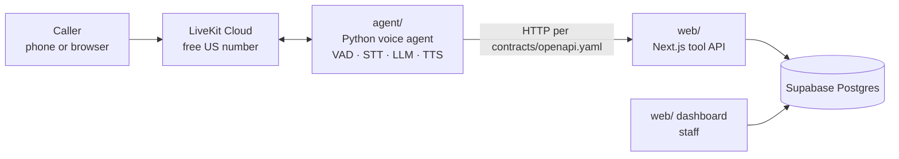

# Restaurant Voice Agent

An AI phone receptionist for restaurants. It answers calls, books, changes and cancels tables, answers menu and hours questions in two languages, and hands off to staff when asked. It is built entirely on free tiers and free models.

## Repository

| Folder | What it holds | Docs |
|---|---|---|
| [`agent/`](agent/) | Real-time voice agent (Python, LiveKit Agents) | [docs/agent.md](docs/agent.md) |
| [`web/`](web/) | Dashboard and tool API (Next.js, TypeScript, Supabase) | [docs/web.md](docs/web.md) |
| [`contracts/`](contracts/) | `openapi.yaml`: the only interface between the two | — |

The two halves meet only at `contracts/openapi.yaml`, and each folder has a single owner (see [`.github/CODEOWNERS`](.github/CODEOWNERS)). For the full project context and rules, see [CLAUDE.md](CLAUDE.md).
